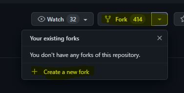
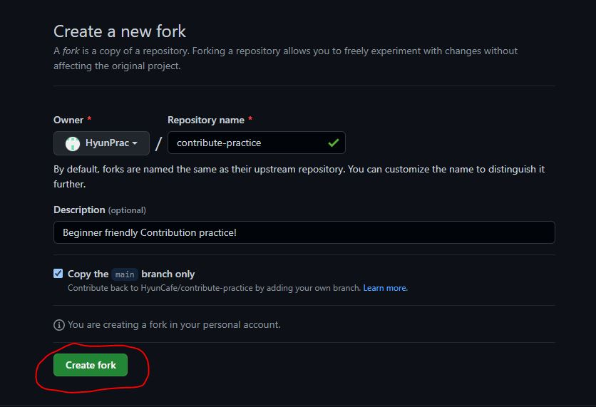
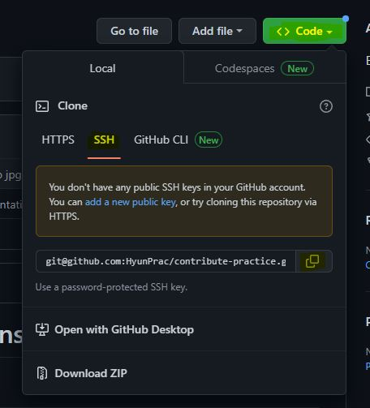
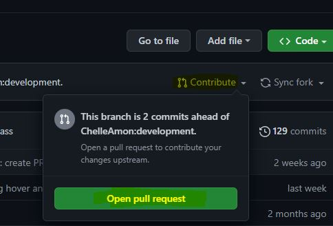
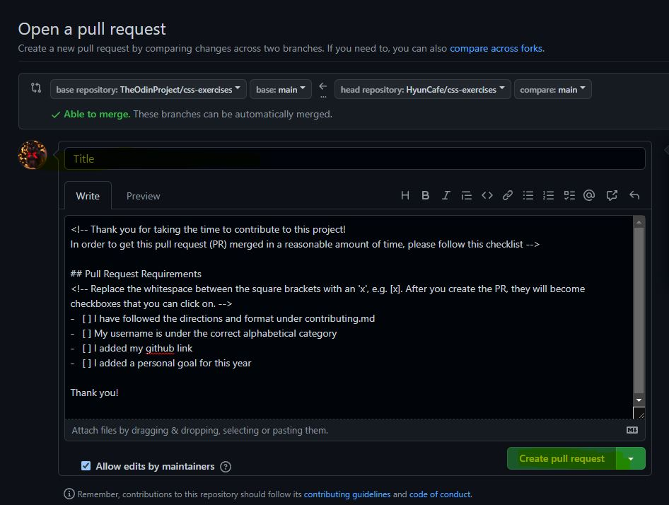

<div align="center">

<h1 align="center">
  
  Your First Open-Source Contribution
  
</h1>

**Learn Git and GitHub by making one real pull request.**

<p align="center">
  
</p>

No coding experience needed. You'll use Git Bash to practice the commands, VS Code to edit one file, and GitHub to share your first contribution.

**[Start the Git Bash walkthrough](#your-first-contribution-step-by-step)** · [Contributor wall](contributing.md) · [Contribution rules](.github/CONTRIBUTING.md) · [Troubleshooting](docs/TROUBLESHOOTING.md)

</div>

---

## Welcome

This repository exists to teach the skills behind open-source collaboration: **fork → clone → branch → edit → commit → push → pull request**.

You'll introduce yourself on our contributor wall and share a learning goal. That is a real, small documentation contribution. The purpose is to practice **Git Bash and GitHub**, not to write code.

> **Your first challenge:** Change **one file** (`contributing.md`), create **one commit**, and open **one pull request**. There is no need to edit the README or install a build system.

<p align="center">
  
</p>

## The journey

```text
GitHub website                 Your computer (Git Bash)                  GitHub website
┌──────────────────┐           ┌────────────────────────────┐           ┌─────────────────────┐
│ Fork the project │ ────────► │ Clone your fork            │           │                     │
└──────────────────┘           │ Create your branch         │           │                     │
                               │ Edit contributing.md only  │           │                     │
                               │ Review → Commit → Push     │ ────────► │ Open pull request   │
                               └────────────────────────────┘           │ Get feedback        │
                                                                        └─────────────────────┘
```

| Term | What it means |
| --- | --- |
| **Fork** | Your personal copy of this GitHub repository. |
| **Clone** | Download your fork with Git history to your computer. |
| **Branch** | A safe place to work on your edit without changing `main`. |
| **Commit** | Record your change in local Git history. |
| **Push** | Send your branch and commit to your fork on GitHub. |
| **Pull request (PR)** | Ask the original repository to review and merge your contribution. |

More definitions are in the [glossary](docs/GLOSSARY.md).

## Before you begin

You will need:

1. A [GitHub account](https://github.com/signup) that you can sign in to.
2. **Git for Windows**, from the [official Git website](https://git-scm.com/downloads/win). It includes **Git Bash**. If you already use Git Bash, you can skip installation.
3. **Visual Studio Code (VS Code)** from [the official website](https://code.visualstudio.com/download). We'll use it to edit the contributor file; no extensions needed.

Open **Git Bash** and verify Git is installed:

```bash
git --version
```

**Commit identity:** Git might ask for your name/email when you make your first commit. For privacy, consider using your [GitHub no-reply email address](https://docs.github.com/en/account-and-profile/how-tos/email-preferences/setting-your-commit-email-address). Don't copy another person's identity.

## Your first contribution: step by step

### 1. Fork this repository on GitHub

1. Sign in to GitHub and open **[HyunCafe/contribute-practice](https://github.com/HyunCafe/contribute-practice)**.
2. Select **Fork** → **Create fork**.
3. Confirm the address looks like `https://github.com/YOUR_USERNAME/contribute-practice`, replacing `YOUR_USERNAME` with **your own** GitHub handle.

**Real URL example:** This project is at `https://github.com/HyunCafe/contribute-practice`. Here, `HyunCafe` is the original owner. After you fork it, your fork will have **your** GitHub username in that position. Don't submit your change to the original repository as though it were your fork.

> You need write access to your fork. You do not need write access to the original repository.

<p align="center">
  
</p>

<p align="center">
  
</p>

*Screenshots from the original tutorial. GitHub's interface may look different today; follow the written instructions above.*

### 2. Clone **your fork** using Git Bash

<p align="center">
  
</p>

**Note:** This older screenshot shows SSH. For your first contribution, select **HTTPS** and follow the commands below instead. You do not need to set up SSH keys.

Open Git Bash in a folder where you'd like to keep your practice project (your home directory is fine).

Replace `YOUR_USERNAME` with your real GitHub username **before running the command**:

```bash
git clone https://github.com/YOUR_USERNAME/contribute-practice.git
cd contribute-practice
```

**Real URL example (original project, not your fork):**

```text
https://github.com/HyunCafe/contribute-practice.git
```

This is the clone URL for **HyunCafe's original repository**. It shows what a complete GitHub clone address looks like. For your first contribution, use the `git clone` command **above**, with `YOUR_USERNAME` replaced by **your own handle**. Otherwise your `origin` remote may point to a repository you cannot push to.

**Check that you cloned the right repository:**

```bash
git remote -v
```

Both `origin` URLs should refer to **your fork**. Do not clone `HyunCafe/contribute-practice` when you intend to push to your own fork.

> `git clone` creates the project folder itself. If you see `destination path ... already exists`, see [troubleshooting](docs/TROUBLESHOOTING.md) rather than deleting a folder.

### 3. Create a branch for your change

```bash
git switch -c add-my-first-contribution
```

This creates and switches to a separate branch. Your local `main` stays unchanged.

### 4. Edit **only** `contributing.md`

From Git Bash, while you're inside your cloned repository, open the project in **VS Code**:

```bash
code .
```

In VS Code's **Explorer** (left sidebar), open `contributing.md`. That's the only file you need to edit. Keep Git Bash open for the Git commands that follow.

If Git Bash says `code: command not found`, reopen Git Bash after installing VS Code and try again. You can also use **File → Open Folder** in VS Code and select your cloned `contribute-practice` folder.

Find the letter matching **the first character of your GitHub username**, not your display name. Insert your entry in case-insensitive alphabetical order: compare the first character, then the second, third, and so on. If a letter section is missing, create it in the proper position. Handles starting with digits belong in `## 0–9 and symbols` at the end.

Here's the entry template. Replace each placeholder with **your own** information:

**Template — what to type in `contributing.md`:**

```md
- **YOUR_DISPLAY_NAME** ([`@YOUR_USERNAME`](https://github.com/YOUR_USERNAME))
  > "YOUR_LEARNING_GOAL"
```

**Completed example — using the repository owner, `HyunCafe`:**

```md
- **HyunCafe** ([`@HyunCafe`](https://github.com/HyunCafe))
  > "My goal is to practice Git, make a small change, and open a pull request."
```

**How it appears on GitHub:**

- **HyunCafe** ([`@HyunCafe`](https://github.com/HyunCafe))
  > "My goal is to practice Git, make a small change, and open a pull request."

This is an **illustrative entry**, not an entry copied from the contributor wall. `HyunCafe` is the repository owner, and the goal shown here is sample wording—not a statement of the maintainer's personal goals. Please enter **your own** username, profile link, and learning goal instead.

For example, `@anna` comes before `@anne`, and `@anne` comes before `@anton`. Your display name can be different from your `@handle`; the **handle in your profile link** determines the order.

**Keep your edit limited to your entry.** Don't edit `README.md`, rewrite anyone else's goal, or reorganize existing records in your first PR. The contributor list is public, so don't include private contact information or passwords.

Press **Ctrl+S** in VS Code to save your change, then return to Git Bash.

### 5. Review the change before committing

Return to Git Bash:

```bash
git status --short
git diff -- contributing.md
git diff --check
```

You should see **only `contributing.md` changed**. For example, this is what `git status --short` often shows after you save:

```text
 M contributing.md
```

Check your spelling, GitHub profile URL, Markdown formatting, and alphabetical placement. If other files changed, investigate before staging or committing.

### 6. Make **one commit**

Stage **only the contributor file**, review the staged change, and commit it:

```bash
git add contributing.md
git diff --cached --name-only
git diff --cached --check
git commit -m "docs: add my contributor profile"
```

The staged-file list should contain only `contributing.md`, like this:

```text
contributing.md
```

If Git asks you to configure your author identity, see [troubleshooting](docs/TROUBLESHOOTING.md#git-doesnt-know-who-i-am).

### 7. Push your branch to your fork

```bash
git push -u origin HEAD
```

If a sign-in window opens, use the official GitHub authentication flow. **GitHub account passwords are not used for Git over HTTPS.** Never paste a token or a two-factor code into a GitHub issue or public PR comment.

### 8. Open your pull request

1. Open **your fork** on GitHub and look for **Compare & pull request**. Alternatively select **Pull requests → New pull request**.
2. Confirm the **base** is `HyunCafe/contribute-practice` on `main` and the **head** is your fork's new branch.
3. Confirm the **Files changed** tab shows **only `contributing.md`**.
4. Give the PR a clear title, such as `docs: add YOUR_USERNAME to contributors`. For the illustrative `HyunCafe` entry shown above, that title would be `docs: add HyunCafe to contributors`. **Use your own handle** for your real PR.
5. Briefly describe what you learned, then click **Create pull request**.

<p align="center">
  
</p>

<p align="center">
  
</p>

*The GitHub interface may have changed since these were taken. Follow the steps above.*

**That's the complete exercise: one file → one commit → one PR.** Your request may remain open while a maintainer reviews it. Watch for comments and follow up if changes are requested.

<p align="center">
  
</p>

**You did it!** You've opened a pull request. That's the same workflow you'll use in other open-source projects. Keep an eye out for feedback, and thanks for joining in!

<p align="center">
  
</p>

## Our contributor wall

<p align="center">
  <a href="https://github.com/HyunCafe/contribute-practice/graphs/contributors">
    
  </a>
</p>


Meet the [community contributors and their learning goals](contributing.md). New names are sorted by **GitHub username**, case-insensitively and character-by-character. Older goals and years are part of this project's history and should not be rewritten.

The wall is maintained in **`contributing.md` alone**. The README contains instructions, not a second contributor list.

## Frequently asked questions

**Do I need to know programming?** No. Your first PR is a small Markdown edit.

**Do I need Python, Node.js, SSH keys, or build tools?** No. Git Bash, GitHub, and VS Code are enough for this exercise. We're using HTTPS, so there's no SSH setup.

**Why use a branch?** It lets you propose an isolated change that the maintainer can review safely.

**Can I edit more than one file?** For this beginner exercise, change only `contributing.md`. Larger documentation fixes are welcome as separate, focused PRs—open an issue first to discuss them.

**Why hasn't my PR merged yet?** Reviews depend on maintainer availability. Creating a correct PR and participating in review are the learning goals; merging is not guaranteed.

## Help and further learning

- [Contribution rules and entry format](.github/CONTRIBUTING.md)
- [Common Git Bash and GitHub problems](docs/TROUBLESHOOTING.md)
- [Plain-language Git glossary](docs/GLOSSARY.md)
- [Community code of conduct](CODE_OF_CONDUCT.md)
- [Maintainer guide](docs/MAINTAINER_GUIDE.md)
- [MIT license](LICENSE)

**Learn more:** [GitHub: Contributing to a project](https://docs.github.com/en/get-started/exploring-projects-on-github/contributing-to-a-project) · [Git: Getting started](https://git-scm.com/book/en/v2/Getting-Started-First-Time-Git-Setup) · [Pro Git (free book)](https://git-scm.com/book/en/v2)

---

Made and maintained by [HyunCafe](https://github.com/HyunCafe), with thanks to everyone who has practiced their first open-source contribution here.
